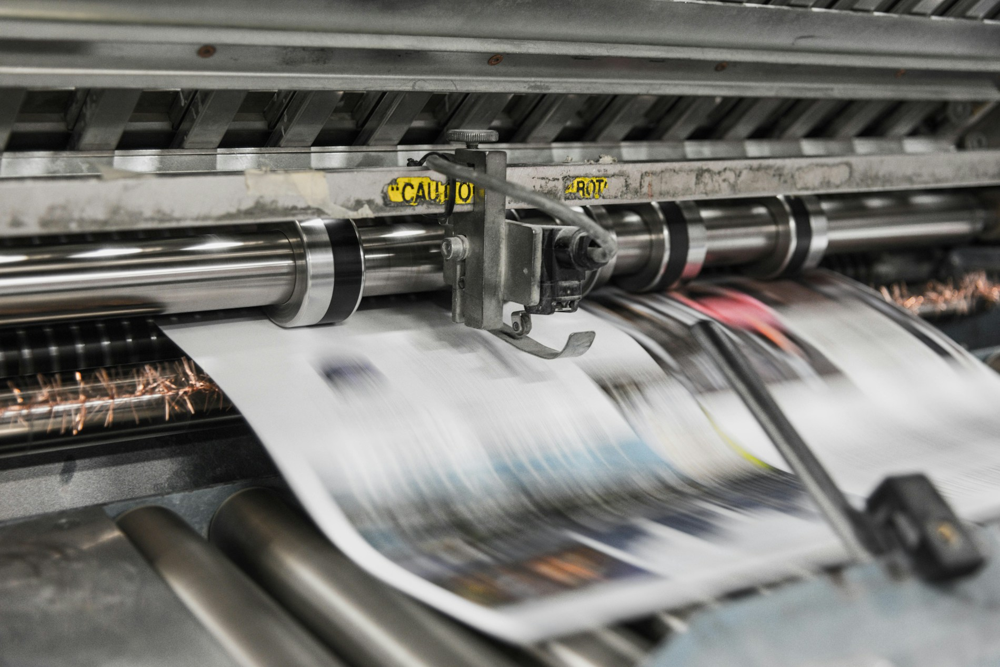

# Beder Printing Center

A responsive, multi-page static website for **Beder Printing Center** — a neighborhood print shop in Mogadishu, Somalia offering printing, copying, scanning, and office supplies.



---

## About

Started in 2009 with one copier by the campus gate, Beder Printing Center is now a trusted printing partner for students, businesses, and the local community in Mogadishu. We make printing simple — from one-page copies to important business documents and large-format banners.

- **Location:** Mogadishu, Somalia
- **Phone:** +252 61 557 2024
- **Email:** hello@beder.so
- **Hours:** Sat – Thu, 8:00 AM – 8:00 PM | Friday Closed

---

## Pages

| Page | Route | Description |
|------|-------|-------------|
| Home | `index.html` | Hero section, value proposition, showcased work |
| About | `about.html` | Company history, milestones, approach |
| Services | `services.html` | Full list of services, pricing, ordering process |
| Products | `products.html` | Product catalog with category filtering |

---

## Features

### Static & Lightweight

- No frameworks — just clean, semantic HTML5, CSS3, and a small vanilla JavaScript file (~4 KB)
- Responsive layout that works on mobile, tablet, and desktop
- Dark/Light-ready color scheme

### Interactive Elements

- **Mobile navigation toggle** — accessible hamburger menu with proper ARIA attributes
- **Product filtering** — filter products by category (Cards & Flyers, Large Format, Finishing) on the products page
- **Dynamic footer year** — automatically updates the copyright year

### Design

- **Typography:** [Fraunces](https://fonts.google.com/specimen/Fraunce) (headings) and [Inter](https://fonts.google.com/specimen/Inter) (body) from Google Fonts
- **SVG brand mark** — inline SVG logo with no external image dependency
- **Imagery:** Optimized Unsplash stock photos with fallback handling via `onerror` handlers

---

## Project Structure

```
beder-printing-center/
├── index.html          # Home page
├── about.html          # About page
├── services.html       # Services page
├── products.html       # Products page
├── styles.css          # Site-wide stylesheet
├── script.js           # Interactive behavior (nav, filter, year)
└── img/                # Source images / assets
```

---

## Running Locally

No build step is required.

1. Open any HTML file directly in your browser, or
2. Serve the directory with a static server for the best experience:

```bash
npx serve .
# or
python -m http.server
```

Then navigate to `http://localhost:3000` (or the port shown in your terminal).

---

## Customization

### Branding

- Update the **logo** and **brand name** in the header/nav markup of each HTML file
- Change **colors** in `styles.css` via the `:root` custom properties
- Replace **typography** link tags in `<head>` to swap Google Fonts

### Adding Services or Products

- **Services:** Add or edit `benefit-card` articles in `services.html`
- **Products:** Add a new `<article class="showcase-card">` with the appropriate `data-cat` value (`cards`, `large`, or `finish`) in `products.html`

### Contact Information

Update the email (`hello@beder.so`), phone number (`+252 61 557 2024`), and address in the footer across all HTML files.

---

## Accessibility

- Semantic HTML5 markup (header, nav, main, footer, section, article)
- `aria-label`, `aria-current`, `aria-expanded`, and `aria-controls` attributes on interactive elements
- Alt text on all images
- Keyboard-navigable mobile menu

---

## License

This project is provided as-is for portfolio and educational purposes. You are free to adapt and reuse it for your own projects.

---

*Made with ink and patience in Mogadishu.*
